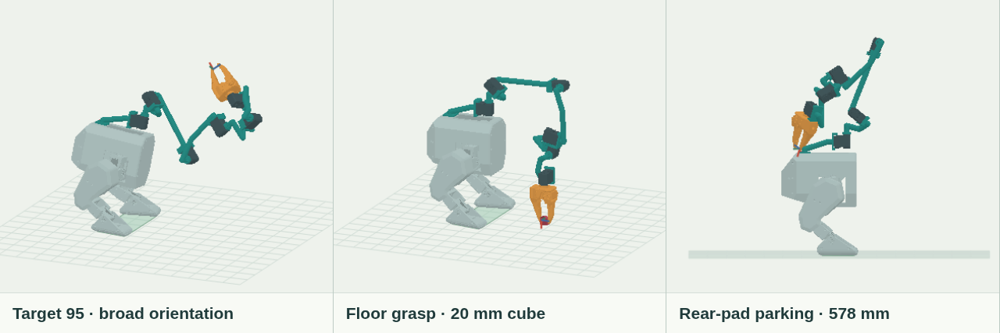
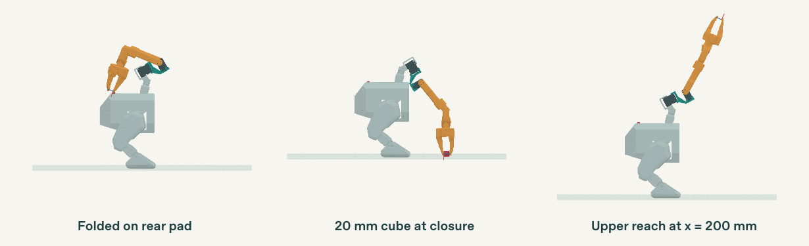

# SO-Duck

## Hollow three-part design at the original neck socket

The neck mount, elbow-to-forearm-roll link and wrist carrier use hollow sections adapted from the SO-101 donor parts. The mount uses the four original neck screws. The arm retains six positioning axes and the gripper.

[Inspect the three parts and their sections](hollow/README.md) · [download the assembly viewer](hollow/viewer.html).

## Earlier six-part grasp-coverage design

The revised SO-Duck arm reaches **96/96 published grasp targets** with both feet planted. It keeps the crosswise elbow and repositions an existing motor to roll the forearm. The resulting six-axis arm retains the stock SO-101 gripper and uses 17 actuators across the robot.

| Grasp target set | Previous crosswise arm | Revised arm |
|---|---:|---:|
| Forward | 45/64 | 64/64 |
| Broad orientation | 12/32 | 32/32 |

[Design and validation](coverage/README.md) · [offline 3D pose explorer](coverage/poses.html) · [custom links in STEP](coverage/mounts.step) · [whole-robot MuJoCo model](coverage/robot.xml).

The revised model also grasps a 20 mm floor cube in kinematic replay and seats its fixed fingertip on the rear roof pad. Its parked height is 578 mm. The 96-target result covers individual endpoint poses with unloaded static balance. Hardware grasp reliability and paths between all targets remain open.

## Previous crosswise design

The earlier design uses a **crosswise forearm connector** on an Open Duck Mini V2 biped. The last Duck neck motor now pitches the stock SO-101 forearm forward and back. The robot has 17 actuators: ten leg joints, four neck/forearm joints, two wrist joints and the gripper. The original head shell is outside the arm load path.

| Open the earlier design | Contents |
|---|---|
| [Connector assembly (STEP)](crosswise/connector_assembly.step) | Yaw servo, printed carrier, crosswise terminal servo and stock forearm in their mounting positions |
| [Carrier STEP](crosswise/carrier.step) · [carrier STL](crosswise/carrier.stl) · [rear pad STL](crosswise/park_pad.stl) | Fabrication geometry in mm |
| [Whole-robot pose explorer](SO_Duck_pose_explorer.html) | Download and open locally to orbit the assembled robot through the fold, floor pickup and upper reach |
| [MuJoCo model](crosswise/robot.xml) · [assembly and reproduction guide](crosswise/README.md) | Complete joint chain, actuator bindings, parking-pad placement, six keyframes and replay checks |

With both feet planted, the folded model is **449 mm high**, down from **659 mm** upright. The fixed finger seats on a small pad bonded to the rear roof. At the floor, the jaws can enclose a 20 mm cube 140 mm ahead of the toes and follow a 30 mm lift. At a separate overhead pose, the gripper reference point reaches **651 mm above the floor** at 200 mm forward of the torso origin. These results come from CAD and kinematic replay. Printed fit, harness clearance, motor duty, grip friction and walking with the arm parked remain unverified.

## Earlier whole-body study

The original longitudinal-roll design, orientation search, changing-stance experiments and published data remain available through the [study index](docs/STUDY_INDEX.md) and [original pose explorer](study/legacy_pose_explorer.html). The [earlier crosswise results](crosswise/nominal_targets.csv) use the crosswise model and its revised joint limits. [Upstream geometry and licenses](docs/PROVENANCE.md) cover Open Duck Mini V2, Duck Playground and TheRobotStudio SO-101.
