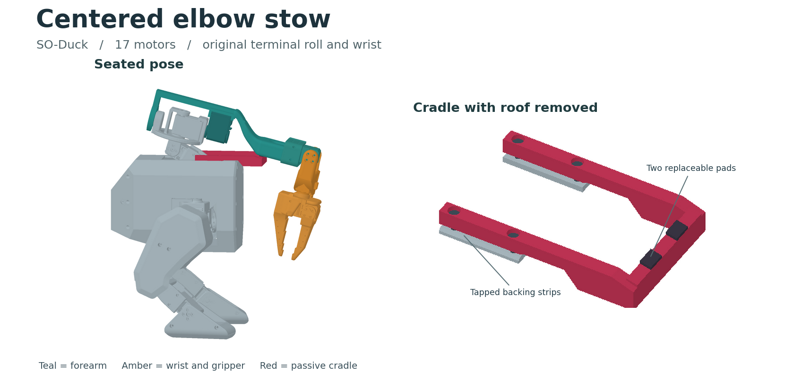

# Centered elbow stow

This 17-motor SO-Duck revision seats the closed, empty forearm on a passive torso-mounted cradle. The original case-mounted forearm, rear roll bearing, yaw axis, terminal roll, two wrist axes and gripper remain available during manipulation. On a 25-tooth STS3215, re-indexing the existing head-pitch horn by one tooth and changing its calibrated operating window gives the elbow enough travel to seat. The rigid elbow pivot can stay in its original location.



[Animated whole-robot assembly](Centered_stow.glb) · [Cradle assembly STEP](Cradle_assembly.step) · [Sampled approach and joint angles](results/stow_path.csv) · [Grasp replay](results/grasp_replay.csv)

## Folding motion and motor datum

Angles below are physical joint coordinates in the SO-Duck study. Positive neck pitch leans the neck rearward. Starting from the centered working pose, the wrist flexes first, the two pitches then move together, and the last 14° of elbow travel lowers the forearm onto the pads. Reverse this sequence to release. The GLB opens in the seated pose and contains an eight-second illustrative animation. Playback speed does not specify a motor trajectory.

| Pose | Neck pitch | Effective head pitch | Indexed elbow motor angle | Wrist flex |
|---|---:|---:|---:|---:|
| Centered working pose | 0° | 0° | +14.4° | 0° |
| Wrist tucked | 0° | 0° | +14.4° | +90° |
| Above pads | +60° | −60° | −45.6° | +90° |
| Both pads seated | +60° | −74° | −59.6° | +90° |

Yaw, terminal roll and wrist roll are zero throughout. The jaw is at its closed model position. Re-seat the **driven head-pitch horn** one spline toward negative effective elbow pitch at the old motor zero. The passive idler follows the fork. The 25T spline gives 14.4° per tooth. In the donor's signed joint coordinates, **effective angle = motor angle − 14.4°**. The encoder direction and zero must correspond to this convention. The old physical working range of −45° to +45° corresponds to motor angles −30.6° to +59.4°. The excursion from −45° down to −74° is modeled only along the centered stow path. This is a mechanical study with no motor-command or firmware changes. [FEETECH STS3215-C001 mechanical drawing](https://files.seeedstudio.com/products/Feetech/108090023_STS3215-C001_Datasheet.pdf)

The donor-mesh spike found neck side-sheet contact with the internal trunk top at +64° of shoulder pitch. Both sheets were clear at +62° on the same 2° grid. The selected path stops at +60°. This avoids a shoulder-hinge redesign.

## Parts and seating geometry

| Part | Qty | Fabrication or source |
|---|---:|---|
| Cradle bridge | 1 | [cradle.stl](cradle.stl), rigid polymer prototype, two rail tops oriented on the print bed |
| Roof panel | 1 | [roof_drilled.stl](roof_drilled.stl), direct replacement for the donor `body_middle_top`, with four Ø3.3 mm through-holes |
| Compliant contact pad | 2 | [contact_pad.stl](contact_pad.stl), identical TPU pieces. Bond on the two inclined lands |
| Backing strip | 2 | Mirror-handed aluminum strips in the [STEP](Cradle_assembly.step), 43 × 7.4 × 3 mm. Tap both Ø2.5 mm bores M3. The upper outboard chamfer clears the roof’s inner corner |
| Fastener | 4 | M3 × 10 button-head screws, Ø5.7 mm head envelope, seated in the bridge counterbores |

The STEP uses the trunk frame in millimetres, with +X forward, +Y left and +Z up. The hole centers lie at X = −14 and +18 mm, Y = ±29.5 mm. The local donor roof is 3 mm thick. Fit the two backing strips under the roof before refitting it. Clamping the roof between the rails and the tapped strips distributes the load. Each pad spans X = 79…85 mm and has a 10 mm width. Finished pad plus adhesive thickness is 1.5 mm vertically, approximately 1.46 mm normal to the inclined seat. Center both pads on their lands.

The arm rests on the structural underside of the existing wrist fork. The pad lands lie outside the bearing retainers and servo horn. Cable routing through this region is unverified. The deck ends at X = 46 mm. The pad centers are **36 mm forward of the original deck edge**, where an upward reaction has leverage to support the distal mass. The wrist and gripper extend **127 mm beyond the original trunk front**, versus 152 mm for the earlier +45°/−45° partial fold. The gripper hangs downward. A strict stow entirely within the original trunk footprint would need different link packaging.

## Verification

The following results use restored native meshes, a level torso, the study’s nominal two-foot stance, a closed jaw and no payload. For static balance the model uses the heavier moving-terminal mass estimate and 32.3 g of additional installed hardware, calculated from solid volumes. Densities in g/cm³ are 1.24 for the bridge, 1.20 for the pads, 2.70 for the backing strips and 7.85 for screw envelopes. Printed infill, tapped holes, drilled-out roof mass and the physical adhesive introduce small differences.

| Check | Result |
|---|---|
| Park and release | Both 6 × 10 mm pads meet the native forearm STEP. Maximum corner-to-surface mismatch below 0.001 mm. Rigid bridge clearance 1.456 mm. The first 0.5° of elbow release opens 1.160 mm at the nearest pad |
| Sampled path | 329 configurations spaced by at most 0.5° per joint. Zero unintended surface intersections across the original 146 robot pairs, added neck checks and fixture-to-moving-link pairs. Minimum nonfoot robot-to-floor clearance 24.7 mm |
| Static balance | Minimum signed center-of-mass margin 31.9 mm along the path and 34.6 mm seated |
| Static load transfer | Empty elbow gravity moment 0.672 N·m. The pads supply a modeled 135.9 mm normal moment arm, giving a combined 4.94 N reaction to balance that elbow moment with the other axes held |
| Roof and fasteners | Native panel re-imports as a closed solid. Four bores remove the calculated four-cylinder volume. Installed bridge, pads, backers and fastener envelopes clear the revised roof volume within the fit-check tolerance |

Stowing is a slow, empty-arm design case. The sampled path does not bound all continuous clearances. No gait, fall, impact, cable sweep, preload controller, positive retaining latch or powered hardware cycle has been demonstrated. Printed stiffness, pad adhesion, roof strength, servo thermal duty and retention during acceleration remain unmeasured. The load estimate is for elbow support with other axes held.

### Forward-grasp regression

All 288 saved grasp configurations were replayed against the new fixed hardware. The table counts previously accepted targets that still pass. The three columns distinguish the published study, the same configurations with the heavier arm mass model, and that heavier model with the cradle installed. Results use the existing 5 mm static-margin threshold.

| Stance and target bank | Published | Heavier arm without cradle | Heavier arm with cradle |
|---|---:|---:|---:|
| Nominal, forward | 45/64 | 40/64 | 40/64 |
| Nominal, broad orientation | 9/32 | 8/32 | 7/32 |
| Replant 220 mm, forward | 43/64 | 34/64 | 34/64 |
| Replant 220 mm, broad orientation | 21/32 | 18/32 | 17/32 |
| Replant 270 mm, forward | 59/64 | 59/64 | 59/64 |
| Replant 270 mm, broad orientation | 26/32 | 26/32 | 26/32 |
| Union of forward targets | **62/64** | **62/64** | **62/64** |
| Union of broad-orientation targets | **26/32** | **26/32** | **26/32** |

The cradle costs one otherwise accepted broad-orientation solution in each of the first two stances. Alternatives in the 270 mm stance preserve both targets. The original joint frames and forward-grasp FK remain valid in effective joint coordinates. Replanting and loaded transitions are outside these endpoint comparisons.

## Reproduce

From the repository root, with Python 3.12, a C++17 compiler, NumPy, SciPy, CadQuery 2.7.0 and VTK 9.3.1:

```sh
python scripts/restore_assets.py
python collision/build_bvh.py
python stow/verify.py --out /tmp/so-duck-stow
```

`python stow/design.py` regenerates the CAD and print meshes. `python stow/preview.py` regenerates the display-only GLB. All collision checks use the full-resolution geometry. The roof derives from the bundled Open Duck Mini V2 mesh, with the original license and source information in [Provenance](../docs/PROVENANCE.md).
